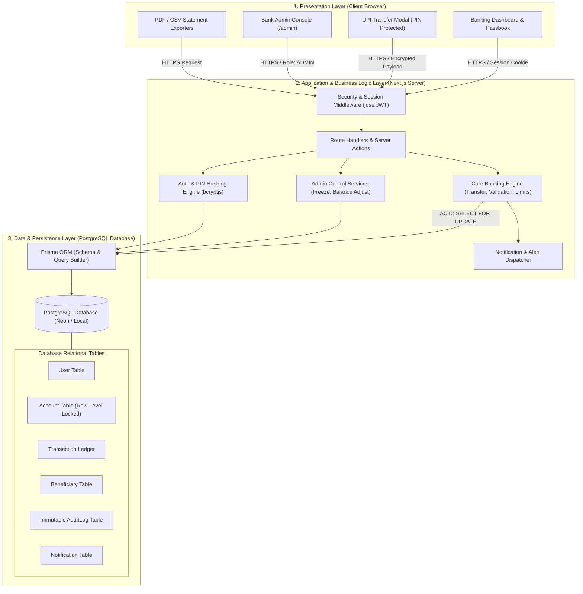
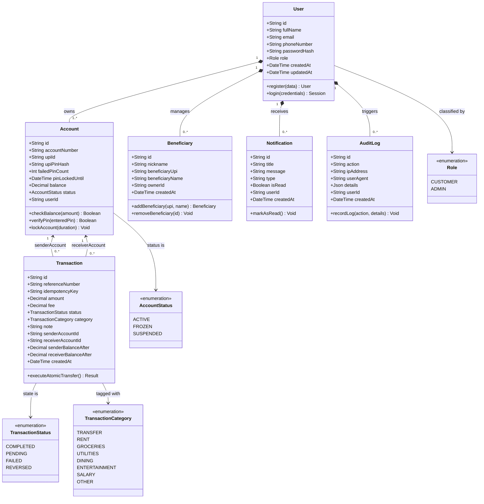
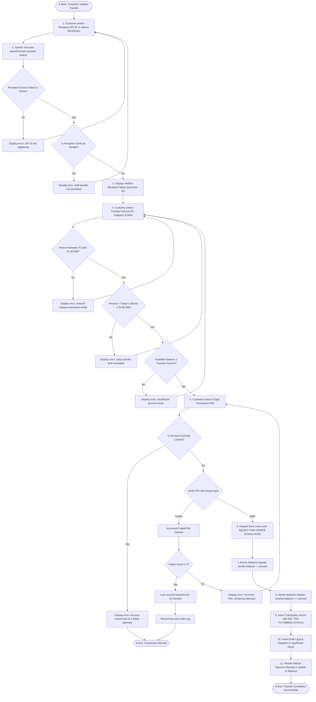
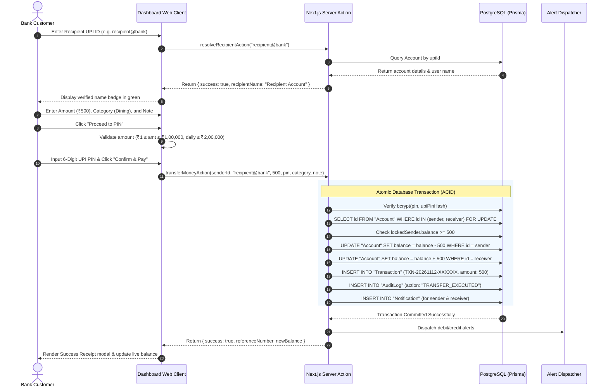

# Software Engineering Architecture & UML Specification
## Bankitis: Online Banking System

This document contains the official **System Architecture Diagram**, **UML Class Diagram**, **UML Activity Diagram**, **UML Use Case Diagram**, and **UML Sequence Diagram** required for academic, lab viva, and technical evaluation.

### 📁 Direct Diagram Files for StarUML, Rational Rose, & Visual Paradigm
You can copy and paste or import these dedicated `.puml` source files directly into **StarUML**, **Rational Rose**, **Visual Paradigm**, or paste into **[PlantText.com](https://www.planttext.com/)** / **[PlantUML Server](https://www.plantuml.com/plantuml/uml/)** to export high-resolution PNGs and PDFs:

| Diagram Name | Dedicated File (.puml) | Best Used In |
| :--- | :--- | :--- |
| **Combined All Diagrams** | [`diagrams/ALL_UML_DIAGRAMS.puml`](./diagrams/ALL_UML_DIAGRAMS.puml) | StarUML, PlantText, VS Code PlantUML |
| **UML Class Diagram** | [`diagrams/ClassDiagram.puml`](./diagrams/ClassDiagram.puml) | StarUML, Rational Rose, Visual Paradigm |
| **UML Activity Diagram** | [`diagrams/ActivityDiagram.puml`](./diagrams/ActivityDiagram.puml) | StarUML, PlantText (Workflow Viva) |
| **3-Tier System Architecture** | [`diagrams/SystemArchitecture.puml`](./diagrams/SystemArchitecture.puml) | Architecture Presentation & Report |
| **UML Use Case Diagram** | [`diagrams/UseCaseDiagram.puml`](./diagrams/UseCaseDiagram.puml) | StarUML, Rational Rose Use-Case View |
| **UML Sequence Diagram** | [`diagrams/SequenceDiagram.puml`](./diagrams/SequenceDiagram.puml) | StarUML, Rational Rose Sequence View |

#### ⚡ How to Paste into StarUML / PlantText (30 Seconds):
1. **Option A (Instant Online Export):** Go to [PlantText.com](https://www.planttext.com/), open any `.puml` file above, copy all text, paste it into the editor, and click **Refresh** &rarr; Export as PNG/SVG.
2. **Option B (StarUML):** In StarUML, install the PlantUML extension (**Tools &rarr; Extension Manager &rarr; search "PlantUML"**), paste the diagram code, or use the class/activity/sequence tools using the entity specifications below.
3. **Option C (Rational Rose):** Import via XMI or use the Class & Activity specifications detailed in Section 2 & 3.

---

## 1. System Architecture Diagram (3-Tier Model)

The banking application adheres to a decoupled, secure **3-Tier Enterprise Architecture**:
1. **Presentation Tier (Client Layer):** Mobile-responsive Next.js React frontend with Tailwind CSS and accessible dialog controls.
2. **Application / Business Logic Tier:** Next.js Server Actions, Zod payload validators, JOSE authentication middleware, and the atomic banking transfer engine.
3. **Data & Persistence Tier:** PostgreSQL relational database with row-level locking (`SELECT ... FOR UPDATE`), managed by Prisma ORM.



---

## 2. UML Class Diagram (Domain & Entity Model)

The class diagram below depicts the system data entities, attributes, data types, visibility, and relational associations:



---

## 3. UML Activity Diagram (Money Transfer & UPI Verification Workflow)

This activity diagram models the step-by-step logic executed during an online funds transfer, including validation rules, security checks, and concurrency control:



---

## 4. UML Use Case Diagram

The use case diagram highlights system capabilities separated by user actors:

```mermaid
flowchart LR
    Customer((Registered Customer))
    Admin((Bank Administrator))
    CoreEngine((Core Banking Engine))

    subgraph Banking_System ["Bankitis Online Banking System"]
        UC1["Sign In / Authenticate"]
        UC2["View Account Balance & Masked No."]
        UC3["Send Money via UPI"]
        UC4["Resolve Recipient Name"]
        UC5["Authorize with 6-Digit PIN"]
        UC6["Add / Manage Beneficiaries"]
        UC7["Browse Registered User Directory"]
        UC8["View Transaction Passbook"]
        UC9["Apply Advanced Filters"]
        UC10["Download PDF / CSV Statements"]
        UC11["View Spending Analytics Charts"]
        UC12["Receive Alerts & Notifications"]
        
        UC13["Monitor Total Bank Liquidity"]
        UC14["Freeze / Unfreeze Customer Accounts"]
        UC15["Execute Balance Adjustments"]
        UC16["Inspect Central Transaction Ledger"]
        UC17["Inspect System Audit Trail"]
    end

    Customer --> UC1
    Customer --> UC2
    Customer --> UC3
    Customer --> UC6
    Customer --> UC7
    Customer --> UC8
    Customer --> UC10
    Customer --> UC11
    Customer --> UC12

    UC3 ..> UC4 : <<include>>
    UC3 ..> UC5 : <<include>>
    UC8 ..> UC9 : <<extend>>

    Admin --> UC1
    Admin --> UC13
    Admin --> UC14
    Admin --> UC15
    Admin --> UC16
    Admin --> UC17

    CoreEngine --> UC4
    CoreEngine --> UC5
    CoreEngine --> UC12
```

---

## 5. UML Sequence Diagram (End-to-End Transfer Execution)



---

*Bankitis Online Banking Architecture Specification.*

