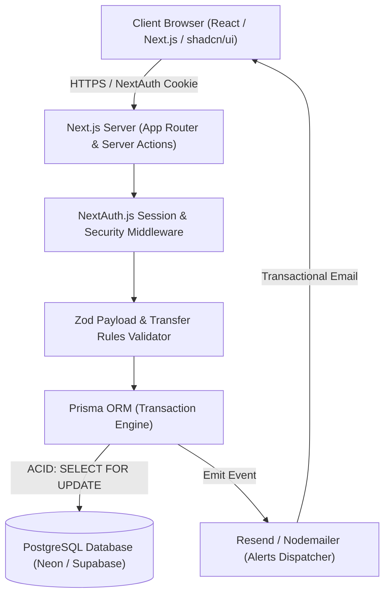
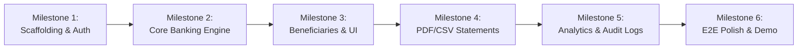

# Product Requirements Document (PRD)
## Team-9: Banking Management System

**Document Version:** 1.0.0  
**Project:** Team-9 Banking Management System  
**Status:** Approved / Ready for Implementation  
**Last Updated:** November 2026  
**Target Platform:** Full-Stack Web Application (Mobile-Responsive Desktop & Web)

---

## 1. Executive Summary

### 1.1 Project Overview
The **Team-9 Banking Management System** is a modern, high-reliability online banking application designed to facilitate seamless, secure, and instantaneous peer-to-peer (P2P) and account-to-account funds transfers using verified internal UPI handles (`username@bank`). 

The system enforces strict financial integrity through atomic database transactions, verified recipient resolution, multi-tier limits, and dedicated transaction authorization (6-digit UPI PIN), alongside bank-grade PDF/CSV statements, real-time notifications, and interactive personal spending analytics.

### 1.2 Core Objectives
- **Zero Double-Spending:** Ensure absolute transactional consistency using PostgreSQL ACID transactions with explicit row-level locking (`SELECT ... FOR UPDATE`).
- **Fraud & Error Prevention:** Mandate recipient verification (name preview) and dedicated 6-digit UPI PIN authentication before funds are committed.
- **Auditable & Compliant:** Maintain complete, immutable audit logs for all security and financial operations with unlimited, filterable transaction histories.
- **Enterprise-Grade User Experience:** Provide a responsive, accessible dashboard powered by Tailwind CSS and shadcn/ui with dark/light mode, real-time alerts, and statement exports.

---

## 2. System Architecture & Tech Stack

| Layer | Technology | Rationale |
| :--- | :--- | :--- |
| **Framework & Runtime** | [Next.js](https://nextjs.org/) (App Router, Server Actions, Route Handlers) | Full-stack TypeScript architecture, optimized SSR/client balance, built-in API routing |
| **Language** | TypeScript (Strict mode enabled) | End-to-end type safety from database models to UI components |
| **Styling & UI Library** | [Tailwind CSS](https://tailwindcss.com/) + [shadcn/ui](https://ui.shadcn.com/) + [Lucide React](https://lucide.dev/) | Sleek, accessible, responsive design system with dark/light themes |
| **Database** | [PostgreSQL](https://www.postgresql.org/) (Neon Serverless / Supabase) | Relational integrity, ACID compliance, row-level locking support |
| **ORM & Migrations** | [Prisma ORM](https://www.prisma.io/) | Type-safe schema definitions, automated migrations, high-performance querying |
| **Authentication** | [NextAuth.js (Auth.js)](https://authjs.dev/) | Secure HTTP-only cookie sessions, bcrypt password hashing, session revocation |
| **Transaction Security** | 6-Digit Hashed UPI PIN (bcrypt) | Strong transaction authorization separated from login password |
| **Statement Exports** | `jsPDF` / `@react-pdf/renderer` + `PapaParse` | Bank-branded PDF statements with watermarks and RFC 4180 CSV exports |
| **Visual Analytics** | [Recharts](https://recharts.org/) | Responsive SVG charts for category breakdowns and cash-flow trends |
| **Notifications** | Resend / Nodemailer + Mock Fallback Logger | Real-time in-app notification center paired with transactional email alerts |
| **Validation** | [Zod](https://zod.dev/) | Strict runtime payload validation for API routes and Server Actions |



---

## 3. User Personas & Permissions

### 3.1 Personas
1. **Registered Customer (Maaz / Priya):**
   - Accesses dashboard with verified credentials.
   - Manages personal bank balance (pre-funded or initial simulated deposit).
   - Manages saved beneficiaries (manual UPI entry or directory search).
   - Executes transfers up to configured transaction and daily limits.
   - Generates and downloads financial statements (PDF and CSV).
2. **System Auditor / Compliance:**
   - Evaluates system-level audit logs for suspicious activities, rapid-fire attempts, or repeated failed PIN attempts.

---

## 4. Detailed Functional Requirements (FRD)

### FR-1: User Authentication & Onboarding
- **FR-1.1:** Users register with Name, Email, Mobile Number, and a secure Login Password.
- **FR-1.2:** Each user is assigned an initial Bank Account number (`ACC1000...`) and a default UPI Virtual Payment Address (VPA) formatted as `username@bank`.
- **FR-1.3:** Setup of a dedicated 6-digit UPI / Transaction PIN during onboarding or account settings, stored strictly as a salted bcrypt hash.
- **FR-1.4:** New registrations receive a simulated initial deposit of **₹50,000** for demonstration and testing purposes.
- **FR-1.5:** Authentication sessions are managed using encrypted, HTTP-only, SameSite=Lax session cookies.

### FR-2: Dashboard & Account Overview
- **FR-2.1:** **Account Summary:** Displays Available Balance, Account Number (masked with toggle to reveal), and active UPI ID.
- **FR-2.2:** **Quick Action Hub:** Direct links to "Send Money", "Add Beneficiary", "Transaction History", and "Download Statement".
- **FR-2.3:** **Recent Activity:** Displays the last 5 transactions with clear visual indicators for credits (green `+`) and debits (red `-`).
- **FR-2.4:** **Quick Analytics Snapshot:** Visual bar of today's utilized daily transfer limit out of ₹2,00,000.

### FR-3: Beneficiary Management
- **FR-3.1:** **Adding Methods:**
  1. *Manual Entry:* User inputs target UPI ID (e.g. `priya@bank`).
  2. *Registered Directory:* User browses or searches the internal directory of registered application users.
- **FR-3.2:** **Automatic Identity Verification:** When a UPI ID is entered, the system asynchronously queries the database and displays the recipient's verified full name before allowing the beneficiary to be saved.
- **FR-3.3:** **No PIN Required to Save:** Adding a beneficiary does not require entering the transaction PIN; PIN is required only when executing funds transfers.
- **FR-3.4:** **Duplicate Prevention:** The system prohibits adding an existing beneficiary twice or adding oneself.

### FR-4: Money Transfer & UPI Flow
- **FR-4.1:** **Recipient Selection:** Customer chooses from saved beneficiaries or enters an ad-hoc registered UPI ID.
- **FR-4.2:** **Name Resolution:** System resolves and displays the recipient's verified name.
- **FR-4.3:** **Amount Boundaries:**
  - Minimum transfer: **₹1**
  - Maximum transfer per transaction: **₹1,00,000**
  - Maximum cumulative daily transfer limit: **₹2,00,000**
  - Transaction fee: **₹0**
- **FR-4.4:** **Balance Verification:** Real-time check verifies that `account.balance >= transferAmount`.
- **FR-4.5:** **Review Screen:** Displays Sender VPA, Recipient VPA, Recipient Verified Name, Transfer Amount, Note/Purpose, and Fee breakdown.

```mermaid
sequenceDiagram
    autonumber
    actor Customer
    participant UI as Web Dashboard
    participant API as Next.js Server Action
    participant DB as PostgreSQL (Prisma)
    participant Notif as Notification Service

    Customer->>UI: Selects Beneficiary or Inputs UPI ID
    UI->>API: Resolve UPI ID
    API->>DB: Check User & Account status
    DB-->>API: Return Recipient Name
    API-->>UI: Display Verified Name
    Customer->>UI: Enters Amount (₹) & clicks "Proceed"
    UI->>UI: Validate limits (₹1 - ₹1,00,000; Daily ≤ ₹2,00,000)
    Customer->>UI: Enters 6-Digit UPI PIN & Confirms
    UI->>API: Execute Transfer (SenderID, RecipientUPI, Amount, PIN, IdempotencyKey)
    
    rect rgb(240, 248, 255)
    Note over API,DB: ACID Transaction Block
    API->>DB: Verify bcrypt(PIN)
    API->>DB: Lock Sender & Recipient rows (SELECT ... FOR UPDATE)
    API->>DB: Check sender.balance >= amount & daily total
    API->>DB: UPDATE sender SET balance = balance - amount
    API->>DB: UPDATE recipient SET balance = balance + amount
    API->>DB: INSERT Transaction (Reference TXN-XXXX, status: COMPLETED)
    API->>DB: INSERT AuditLog records
    end

    DB-->>API: Transaction Committed
    API->>Notif: Trigger in-app notification & Email alert
    API-->>UI: Success response with Reference No.
    UI-->>Customer: Display Success Receipt & Updated Balance
```

### FR-5: Transaction Processing & Concurrency Protection
- **FR-5.1:** Transfers run within an atomic `prisma.$transaction` block.
- **FR-5.2:** Row-level locks (`SELECT ... FOR UPDATE`) are acquired in deterministic order (sorted by Account ID) to prevent database deadlocks.
- **FR-5.3:** **Reference Number:** Generates a unique, high-entropy reference ID formatted as `TXN-YYYYMMDD-XXXXXX`.
- **FR-5.4:** **Idempotency Guard:** Every transfer request includes a client-generated UUID token. Re-submitting the same token within 5 minutes returns the existing receipt without duplicate debiting.
- **FR-5.5:** **Failure Resilience:**
  - If sender balance is insufficient: Abort with code `ERR_INSUFFICIENT_FUNDS`.
  - If PIN validation fails: Abort with code `ERR_INVALID_PIN` and increment failed attempts counter.
  - 3 consecutive failed PIN attempts trigger a 15-minute temporary transfer freeze on the account.

### FR-6: Transaction History & Advanced Filtering
- **FR-6.1:** Access to full, unlimited transaction history.
- **FR-6.2:** **Filter Criteria:**
  - Date Range (Today, Last 7 Days, This Month, Custom Date Range)
  - Amount Range (Min ₹ and Max ₹)
  - Status (`SUCCESS`, `PENDING`, `FAILED`)
  - Transaction Type (`ALL`, `DEBIT`, `CREDIT`)
  - Recipient / Keyword Search (Name, UPI ID, Reference Number)
- **FR-6.3:** Real-time search with debounced inputs and pagination.

### FR-7: Account Statement Generation
- **FR-7.1:** **PDF Statement:**
  - Bank header with logo, user account details, statement period, and opening/closing balance.
  - Tabular list of transactions with Date, Description/Counterparty, Reference No., Debit, Credit, and Running Balance.
  - Clean bank styling with official watermark and footer disclaimer.
- **FR-7.2:** **CSV Export:**
  - RFC 4180 compliant CSV format suitable for Excel, Google Sheets, or tax computation tools.
  - Columns: `Transaction Date`, `Reference ID`, `Type`, `Counterparty Name`, `Counterparty UPI`, `Amount (INR)`, `Status`, `Balance After Transaction`.

### FR-8: Spending Analytics & Insights
- **FR-8.1:** **Monthly Spend Chart:** Visual breakdown of money sent vs. money received over the past 6 months.
- **FR-8.2:** **Category Tagging:** Users can select transfer categories (e.g. Rent, Groceries, Utilities, Personal, Dining, Entertainment).
- **FR-8.3:** **Category Distribution:** Pie / Donut chart showing spending proportion by category for the current calendar month.

### FR-9: Customer Notifications & Alerts
- **FR-9.1:** **In-App Notification Center:** Bell icon in navigation bar displaying unread count and real-time dropdown of:
  - Debit alert: "₹X,XXX debited for transfer to [Recipient]."
  - Credit alert: "₹X,XXX credited from [Sender]."
  - Security alerts: "New device login detected" or "UPI PIN updated."
- **FR-9.2:** **Email Notifications:**
  - Transactional HTML email sent via Resend / Nodemailer for every debit/credit exceeding ₹100.
  - Fallback: Local console logger for seamless offline/development mode.

### FR-10: Audit Trails & Security
- **FR-10.1:** An immutable `AuditLog` table stores every critical event:
  - Login attempts (successful & failed)
  - Transfer attempts (with IP address, timestamp, outcome, and error reasons)
  - Beneficiary additions and deletions
  - UPI PIN modifications

---

## 5. Non-Functional Requirements (NFR)

| Category | Requirement Specification |
| :--- | :--- |
| **Data Consistency** | Strict Serializability / ACID transactions. Zero tolerance for negative balances or phantom debits. |
| **Response Latency** | Transfer verification and execution API latency < 300ms under standard network conditions. |
| **Security & Cryptography** | Passwords and 6-digit UPI PINs hashed using bcrypt with work factor 10. Passwords and PINs never logged in plaintext. |
| **Session Hardening** | JWT sessions signed with 256-bit secret, stored in `HttpOnly`, `SameSite=Lax`, `Secure` cookies. |
| **Rate Limiting** | Max 5 transfer attempts per minute per IP/Session to prevent automated brute-forcing. |
| **Cross-Browser & Device** | Fully responsive layout supported on Chrome, Safari, Firefox, Edge, and iOS/Android mobile browsers. |
| **Accessibility** | Semantic HTML5, ARIA labels on all modal dialogues and numeric PIN inputs, adhering to WCAG 2.1 AA. |

---

## 6. Database Schema Design (Prisma)

```prisma
datasource db {
  provider = "postgresql"
  url      = env("DATABASE_URL")
}

generator client {
  provider = "prisma-client-js"
}

enum Role {
  CUSTOMER
  ADMIN
}

enum AccountStatus {
  ACTIVE
  FROZEN
  SUSPENDED
}

enum TransactionStatus {
  COMPLETED
  PENDING
  FAILED
  REVERSED
}

enum TransactionType {
  DEBIT
  CREDIT
}

enum TransactionCategory {
  TRANSFER
  RENT
  GROCERIES
  UTILITIES
  DINING
  ENTERTAINMENT
  SALARY
  OTHER
}

model User {
  id            String         @id @default(cuid())
  fullName      String
  email         String         @unique
  phoneNumber   String         @unique
  passwordHash  String
  role          Role           @default(CUSTOMER)
  createdAt     DateTime       @default(now())
  updatedAt     DateTime       @updatedAt

  accounts      Account[]
  beneficiaries Beneficiary[]  @relation("UserBeneficiaries")
  notifications Notification[]
  auditLogs     AuditLog[]
}

model Account {
  id              String         @id @default(cuid())
  accountNumber   String         @unique
  upiId           String         @unique // e.g. maaz@bank
  upiPinHash      String         // 6-digit hashed PIN
  failedPinCount  Int            @default(0)
  pinLockedUntil  DateTime?
  balance         Decimal        @default(50000.00) @db.Decimal(14, 2)
  status          AccountStatus  @default(ACTIVE)
  userId          String
  user            User           @relation(fields: [userId], references: [id], onDelete: Cascade)
  createdAt       DateTime       @default(now())
  updatedAt       DateTime       @updatedAt

  sentTransfers   Transaction[]  @relation("SenderAccount")
  recvTransfers   Transaction[]  @relation("ReceiverAccount")

  @@index([upiId])
  @@index([accountNumber])
}

model Beneficiary {
  id              String         @id @default(cuid())
  nickname        String?
  beneficiaryUpi  String
  beneficiaryName String
  ownerId         String
  owner           User           @relation("UserBeneficiaries", fields: [ownerId], references: [id], onDelete: Cascade)
  createdAt       DateTime       @default(now())

  @@unique([ownerId, beneficiaryUpi])
  @@index([ownerId])
}

model Transaction {
  id              String              @id @default(cuid())
  referenceNumber String              @unique // e.g. TXN-20261111-AB12CD
  idempotencyKey  String?             @unique
  amount          Decimal             @db.Decimal(12, 2)
  fee             Decimal             @default(0.00) @db.Decimal(6, 2)
  status          TransactionStatus   @default(COMPLETED)
  category        TransactionCategory @default(TRANSFER)
  note            String?
  
  senderAccountId String
  senderAccount   Account             @relation("SenderAccount", fields: [senderAccountId], references: [id])
  
  receiverAccountId String
  receiverAccount Account             @relation("ReceiverAccount", fields: [receiverAccountId], references: [id])

  senderBalanceAfter   Decimal        @db.Decimal(14, 2)
  receiverBalanceAfter Decimal        @db.Decimal(14, 2)

  createdAt       DateTime            @default(now())

  @@index([senderAccountId, createdAt])
  @@index([receiverAccountId, createdAt])
  @@index([referenceNumber])
}

model Notification {
  id        String   @id @default(cuid())
  title     String
  message   String
  type      String   // DEBIT, CREDIT, SECURITY, SYSTEM
  isRead    Boolean  @default(false)
  userId    String
  user      User     @relation(fields: [userId], references: [id], onDelete: Cascade)
  createdAt DateTime @default(now())

  @@index([userId, isRead])
}

model AuditLog {
  id        String   @id @default(cuid())
  action    String   // e.g. LOGIN_SUCCESS, TRANSFER_EXECUTED, PIN_CHANGE
  ipAddress String?
  userAgent String?
  details   Json?
  userId    String?
  user      User?    @relation(fields: [userId], references: [id], onDelete: SetNull)
  createdAt DateTime @default(now())

  @@index([userId, action])
  @@index([createdAt])
}
```

---

## 7. API & Server Action Interface Specifications

### 7.1 Resolve Recipient UPI
- **Endpoint:** `POST /api/transfer/resolve-recipient`
- **Request Body:** `{ "upiId": "priya@bank" }`
- **Response (200):**
  ```json
  {
    "success": true,
    "data": {
      "upiId": "priya@bank",
      "recipientName": "Priya Sharma",
      "isSelf": false
    }
  }
  ```
- **Response (404):** `{ "success": false, "message": "UPI ID not registered in system" }`

### 7.2 Execute Money Transfer (Atomic)
- **Endpoint:** `POST /api/transfer/execute`
- **Request Body:**
  ```json
  {
    "recipientUpi": "priya@bank",
    "amount": 2500.00,
    "upiPin": "123456",
    "category": "DINING",
    "note": "Dinner bill split",
    "idempotencyKey": "9b1deb4d-3b7d-4bad-9bdd-2b0d7b3dcb6d"
  }
  ```
- **Response (200):**
  ```json
  {
    "success": true,
    "data": {
      "referenceNumber": "TXN-20261111-9F42B1",
      "amount": 2500.00,
      "recipientName": "Priya Sharma",
      "timestamp": "2026-11-11T23:55:00.000Z",
      "newBalance": 47500.00
    }
  }
  ```

---

## 8. Development Roadmap & Implementation Milestones



1. **Milestone 1: Project Setup & Authentication (Day 1)**
   - Initialize Next.js 14/15 App Router project with TypeScript and Tailwind CSS.
   - Configure shadcn/ui components (Button, Dialog, Card, Input, Table, Dropdown).
   - Set up PostgreSQL schema with Prisma ORM.
   - Implement NextAuth.js credentials provider with bcrypt password and PIN setup.
   - Create database seed script with pre-populated demo users (`maaz@bank`, `priya@bank`, `rahul@bank`).

2. **Milestone 2: Core Banking Engine & Atomic Transfers (Day 2)**
   - Implement row-level locked transfer transaction logic in Prisma (`$transaction`).
   - Implement balance and daily transfer limits check (`₹1 - ₹1,00,000` per txn; `₹2,00,000` daily).
   - Implement 6-digit PIN verification and rate-limiting / lockout mechanism.
   - Integrate idempotency token protection.

3. **Milestone 3: Beneficiary Management & Transfer UI (Day 3)**
   - Build interactive Send Money wizard with real-time UPI ID resolution and name preview.
   - Implement Beneficiary manager (manual addition & registered user directory search).
   - Build responsive customer banking dashboard with live balance toggles.

4. **Milestone 4: Transaction History & Statement Downloads (Day 4)**
   - Implement advanced history filtering (date range, amount range, search, credit/debit).
   - Integrate `jsPDF` for styled, printable bank statements with reference headers and watermarks.
   - Integrate `PapaParse` for RFC-compliant CSV statement downloads.

5. **Milestone 5: Notifications & Spending Analytics (Day 5)**
   - Build in-app notification center with read/unread statuses.
   - Configure transactional email service (Resend / Nodemailer with fallback mock logger).
   - Implement Recharts spending insights (Monthly trends & Category breakdown).

6. **Milestone 6: Verification, Audit Logging & Presentation Readiness (Day 6)**
   - End-to-end testing of edge cases (insufficient funds, concurrency race conditions, invalid PIN).
   - Verify audit log event recording.
   - Prepare final project demonstration scripts and README documentation.

